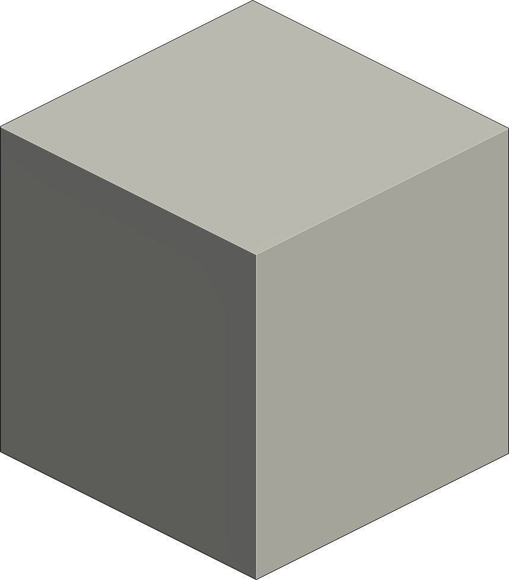

      
      

      &ensp;&ensp;&ensp;&ensp;&ensp;&ensp;&ensp;
      &ensp;&ensp;&ensp;&ensp;&ensp;&ensp;&ensp;&ensp;
      &ensp;&ensp;&ensp;&ensp;&ensp;&ensp;&ensp;&ensp;
      

 
 

      
      &ensp;&ensp;&ensp;&ensp;&ensp;&ensp;&ensp;&ensp;
      

      

